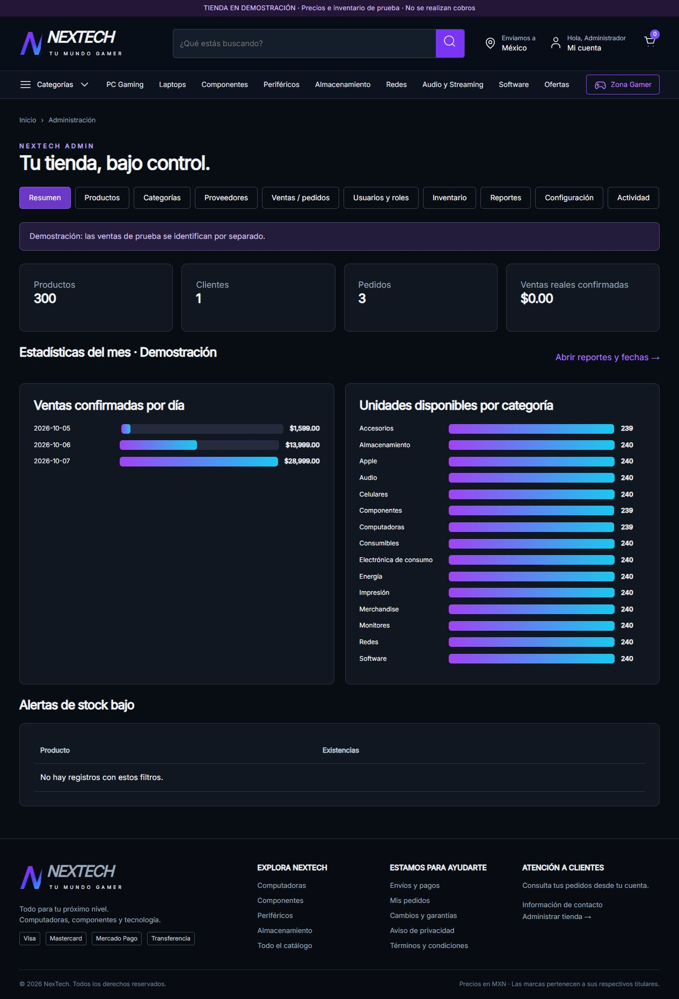
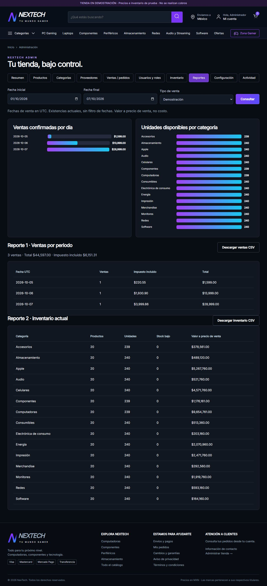

# NexTech - Punto de venta y tienda de tecnología

## Versiones y trabajo del equipo

`main` conserva la tienda actual; `version-preliminar` identifica la primera versión registrada, sin alterar autores ni fechas. Consulta [la comparación de versiones](docs/VERSIONES.md), [los pasos para colaborar](CONTRIBUTING.md) y [las tareas propuestas para los seis integrantes](docs/TAREAS-EQUIPO.md). Las aportaciones nuevas se registran desde `main`, con la identidad de quien efectivamente las realiza.

## Descripción y objetivo
Aplicación web en español para consultar tecnología, gestionar cuentas, vender mediante carrito y controlar productos, categorías, proveedores, usuarios, inventario y pedidos. Separa interfaz, API REST, reglas del servidor y persistencia relacional. Diseño oscuro morado/cian, adaptable a escritorio, tableta y teléfono.

**Versión académica 2.0 - 6 de octubre de 2026.** Incluye 300 modelos de productos, 15 categorías iniciales, 18 tablas, 56 rutas REST, dos roles, cuatro CRUD administrativos y dos reportes con gráficas. Importes y existencias de demostración no son cotizaciones ni inventario comercial confirmado.

## Datos académicos
- Institución: Instituto Tecnológico Superior de Irapuato
- Materia: Desarrollo de Apps Web
- Docente: Francisco Hunahpu Sahagun González
- Grupo: Ing. Informática
- Fecha de entrega: 6 de noviembre de 2026
- Integrantes: Soto Saavedra Erwin Emmanuel; Aguirre Sierra Juan Damián; Crisanto Vázquez Sofía; Rosales Alarcón Amairani; Gutiérrez Rocha Kevin Yahir; Rivera Alvarado Itzel Daniela.
- Contribuciones individuales: pendientes de documentar con evidencia del equipo.
- Repositorio del equipo: [https://github.com/EESH02011/NEXTECH-](https://github.com/EESH02011/NEXTECH-)
- Sitio previsto: [https://mamawevo.com/](https://mamawevo.com/) (pendiente de despliegue y validación).

## Tecnologías y requisitos
- PHP 8.2+ (probado localmente con 8.4.26), extensiones PDO, PDO MySQL o SQLite, cURL, OpenSSL, mbstring y fileinfo.
- MySQL 8.0.16+ o MariaDB 10.6+ en el servidor; SQLite para desarrollo y pruebas locales.
- HTML5, CSS, JavaScript nativo. PHPMailer incluido con su licencia.
- Node.js 22+ únicamente para ejecutar pruebas; no se necesita Node, Composer ni Docker en Hostinger.
- HTTPS, espacio para imágenes y permisos de escritura limitados en private/storage y public_html/uploads.

## Estructura
```text
.env.example           Variables sin secretos
public_html/           Frontend y entrada HTTP de API/instalador
private/               Backend, esquema, catálogo, pagos y correo
database/              schema.sql, seed.sql y guía
scripts/               Datos demo, respaldo, exportación y migración local
test/                  Pruebas de integración
docs/                  API, diccionario, diagramas, trazabilidad y evidencias
```
private debe estar fuera de la raíz pública. El frontend solo usa la API; no contiene credenciales de base de datos.

## Instalación en Hostinger (base nueva)
1. Descarga el ZIP, descomprímelo y crea una base MySQL y su usuario en tu alojamiento PHP. Activa HTTPS.
2. Sube el contenido de public_html a la carpeta pública del dominio. Sube private a su lado. Si usarás scripts, database o docs, déjalos fuera de public_html.
3. Copia .env.example como .env junto a private/public_html. Completa APP_URL (dominio HTTPS sin barra final), APP_ENV=production y DB_HOST, DB_PORT, DB_NAME, DB_USER, DB_PASSWORD. No publiques .env ni lo subas a Git. Alternativamente se admite private/.env si el panel no deja escribir en la carpeta superior.
4. Habilita las extensiones PHP indicadas. Da permisos de escritura al usuario del sitio, evitando permisos globales 777.
5. El paquete privado para Hostinger incluye private/setup.key. Si clonaste Git o descargaste el ZIP de código para GitHub, genera la clave con `php scripts/setup-key.php`; esa clave no se publica.
6. Abre https://tu-dominio/install.php. Usa esa clave y elige tu correo y contraseña de administrador. El instalador crea esquema, roles y catálogo. No importes SQL por separado si usas el instalador.
7. Entra por Mi cuenta. Después elimina install.php y setup.key del servidor; conserva private/installed.lock.
8. Comprueba GET /api.php/bootstrap y /api.php/products. El servidor debe permitir PATH_INFO en PHP. Prueba crear cuenta, carrito y pedido en demostración antes de habilitar ventas.

Alternativa de base de datos: importar database/schema.sql y database/seed.sql en una base vacía; después abrir install.php para crear el administrador. El SQL semilla no incluye usuarios con contraseñas fijas. La aplicación se instala con stock cero y ventas de demostración.

## Ejecución académica local
```text
copiar .env.example como .env
APP_ENV=development
APP_URL=http://127.0.0.1:8088
DB_DRIVER=sqlite
DB_PATH=ruta_absoluta_a_una_base_nueva.db
php scripts/demo.php
php -S 127.0.0.1:8088 -t public_html
```
Después abre http://127.0.0.1:8088. El frontend y backend comparten servidor. scripts/demo.php crea dos usuarios (admin@nextech.test y customer@nextech.test) con contraseñas aleatorias en private/storage/demo-accounts.json, 12 unidades ficticias por producto y tres ventas de prueba. Se niega a modificar bases con usuarios. No publiques ese archivo ni uses datos demo en producción.

NEXTECH_CONFIG permite seleccionar un archivo PHP de configuración para pruebas aisladas y compatibilidad local; producción utiliza .env. scripts/upgrade-sqlite.php actualiza la base local anterior conservando respaldos. No sustituye una migración MySQL de una tienda ya desplegada: antes de actualizar una instancia real hay que respaldarla y ensayar la migración.

## Funciones y uso
Cliente: registro, acceso, perfil, contraseña, recuperación, direcciones, favoritos, búsqueda por nombre/marca/SKU/descripción, filtros y orden, carrito, compra, historial y seguimiento. El enlace Laptops filtra Computadoras + laptop y devuelve 12 modelos del catálogo inicial.

Administrador: resumen, productos (incluye carga de imágenes), categorías, proveedores, usuarios/roles, ventas/pedidos, movimientos de inventario, reportes, configuración y auditoría. Las listas principales tienen búsqueda, filtros, orden y paginación. Productos, categorías, proveedores y usuarios se desactivan conservando su historial. Se protegen las categorías/proveedores con productos activos y el acceso del último administrador.

Ventas: el servidor valida stock, recalcula importes, guarda cabecera/detalle, descuenta existencias, registra movimientos y auditoría en una transacción. Los precios incluyen una tasa uniforme configurable (1600 puntos base = 16% en la demostración); se muestra base e impuesto sin sumarlo dos veces. El régimen tributario real debe configurarse según el negocio: no hay facturación fiscal ni tasas distintas por producto.

Cancelar un pedido pendiente devuelve stock una sola vez. El administrador puede anular una venta de demostración pagada/en preparación indicando motivo. Los pagos reales ya confirmados requieren gestionar su devolución con la pasarela; no se marcan como reembolsados automáticamente. No se eliminan ventas finalizadas.

Reportes: ventas confirmadas por fechas UTC y tipo real/demo; inventario actual por categoría. Incluyen dos gráficas y descarga CSV. Las ventas canceladas se excluyen. El inventario representa existencias actuales y valor a precio de venta, no utilidad ni costo.

## API y seguridad
Base /api.php. Ejemplos: GET /api.php/products, POST /api.php/auth/login, PUT /api.php/admin/products/1, DELETE /api.php/admin/categories/clave, PATCH /api.php/admin/orders/folio y GET /api.php/admin/reports?start=2026-10-01&end=2026-10-06&scope=demo.

Consulta docs/api.md para las 56 rutas, cuerpos, respuestas, permisos y errores. GET /bootstrap proporciona el token CSRF; toda escritura requiere X-CSRF-Token salvo webhooks firmados. Sesión HttpOnly/SameSite, Secure con HTTPS, caducidad por inactividad, contraseñas con password_hash, consultas preparadas, RBAC en servidor, invalidación por auth_version y límites de intentos. Los códigos diferencian éxito, validación, conflicto, acceso y fallos internos.

## Preparación comercial, pagos y correo
Confirma modelos, variantes, precios, existencias, abastecimiento y autorización de imágenes; marca cada producto verificado. Completa contacto, identidad comercial, políticas y pagos en Configuración antes de desactivar la demostración. Los precios del catálogo son ilustrativos. Las licencias digitales requieren definir presentación, duración y entrega; las fotografías de familia pueden ser ilustrativas.

Configura MP_ACCESS_TOKEN y MP_WEBHOOK_SECRET o STRIPE_SECRET_KEY y STRIPE_WEBHOOK_SECRET en .env. Las notificaciones pueden usar /api.php/webhooks/mercadopago y /api.php/webhooks/stripe; también se mantienen las URLs antiguas ?action=webhook-mercadopago y ?action=webhook-stripe. Stripe: eventos checkout.session.completed y checkout.session.async_payment_succeeded. Ambos conectores verifican firma y consultan al proveedor antes de confirmar importe, moneda y referencia. Los medios disponibles dependen de tu cuenta del proveedor. PayPal directo no está integrado.

Transferencias: configura instrucciones desde Administración y confirma solo pagos verificados. SMTP: define SMTP_HOST, SMTP_PORT, SMTP_ENCRYPTION, SMTP_USER, SMTP_PASSWORD, SMTP_FROM y SMTP_NAME. En desarrollo los mensajes se registran localmente y no se envían. No se guardan tarjetas en NexTech.

Pendientes reservan stock hasta su resolución; no existe caducidad automática. Guías de envío, devoluciones externas, controversias y licencias se gestionan manualmente. No incluye CFDI, cotización automática de paquetería, compras a proveedores ni reembolso automático.

## Pruebas y evidencias
```text
PHP_BINARY=ruta_a_php
node test/integration.mjs
```
En PowerShell usa `$env:PHP_BINARY='ruta_a_php.exe'` antes del comando Node. Las pruebas crean una base temporal aislada y usan el puerto 8089 (TEST_PORT permite cambiarlo). 23 grupos aprobados; resultados en docs/evidencias/pruebas.json. Se comprobó el guardado por interfaz, búsqueda de laptops, reportes y ancho de pantalla 390/768/escritorio. Capturas en docs/evidencias.

No se ha desplegado en tu cuenta de Hostinger ni probado pagos/SMTP reales. La verificación ejecutada de base de datos es SQLite; la prueba sobre MySQL de Hostinger permanece pendiente de acceso al servidor. No se presentan estas integraciones como certificadas en producción.

## Respaldo, Git y documentación
Respalda MySQL, .env, uploads e installed.lock. scripts/backup.php exporta MySQL a private/storage; protege las copias y prueba su restauración. Nunca publiques .git, .env, claves, bases locales o credenciales demo.

Git se inició durante esta revisión, con autor explícito NexTech automation. No existía historial previo en la carpeta recibida. El historial nuevo documenta cambios reales de esta revisión; **no acredita desarrollo previo ni participación de integrantes**. El requisito de historial progresivo y contribución del equipo sigue pendiente de evidencia auténtica. El equipo proporcionó el repositorio https://github.com/EESH02011/NEXTECH-. Esta actualización documental no configura el remoto local ni publica cambios; el enlace no acredita por sí solo el historial de participación.

Documentación: docs/api.md, docs/database.md, docs/cumplimiento.md, docs/diagrams y docs/evidencias. El PDF entregado incluye los 16 apartados solicitados, datos académicos proporcionados por el equipo y límites verificables; se incluyen el repositorio del equipo y el dominio previsto, cuyo despliegue sigue pendiente. Referencias de productos en CATALOGO-FUENTES.csv. La auditoría se basa en Requerimientos_Proyectos_Finales_Software.md y Lineamientos_Documentacion_Proyecto_Final_Software.pdf proporcionados por el usuario.



